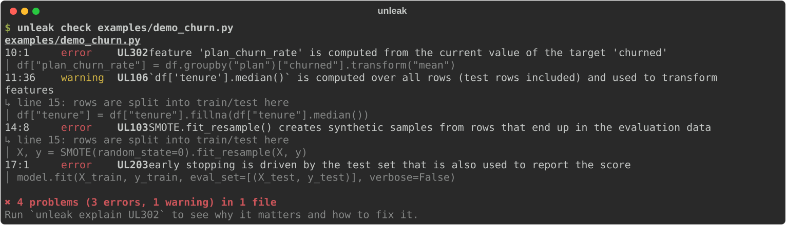

<p align="center">
  
</p>

<h1 align="center">unleak</h1>

<p align="center">
  <b>在指标骗你之前，揪出机器学习代码里的数据泄漏。</b><br>
  一个面向 Python 脚本和 Jupyter Notebook 的静态分析器，外加一个 Agent 技能和一个写入钩子，<br>
  让 Claude Code、Codex、Cursor 不再交出"泄漏"的模型。
</p>

<p align="center">
  <a href="https://pypi.org/project/unleak/"></a>
  <a href="https://pypi.org/project/unleak/"></a>
  <a href="https://github.com/OWNER/unleak/actions/workflows/ci.yml"></a>
  <a href="#配合-ai-编程助手使用"></a>
  <a href="#配合-ai-编程助手使用"></a>
  <a href="LICENSE"></a>
</p>

<p align="center"><a href="README.md">English</a> · <b>简体中文</b></p>

<p align="center"></p>

你的不平衡分类模型 F1 是 **0.98**，换成它从没见过的数据，只剩 **0.21**。整个过程没有报错，也没有任何警告，
只是因为 SMOTE 写在了 `train_test_split` 的上一行。

这就是**数据泄漏**：测试集的信息混进了训练过程，分数衡量的是"记忆"而不是"能力"。它是机器学习结论无法复现的
头号原因。Kapoor 和 Narayanan 在 [17 个学科、294 篇论文](https://doi.org/10.1016/j.patter.2023.100804)里发现了它；
教程、Kaggle Notebook 里更是随处可见，而这些正是 AI 编程助手学习的素材。

**unleak** 只读代码（不运行代码，也不碰你的数据），直接指出测试信息从哪一行漏进了训练，告诉你原因和改法。
每个文件只需几毫秒，除了 Python 3.10+ 什么都不依赖，还能接进你的 AI 编程助手，在代码写下的那一刻就把泄漏拦住。

## 泄漏到底让指标虚高多少（实测）

每一行都对应 [`examples/`](examples) 里一个可运行的例子：同一份数据，一个版本有泄漏，一个版本没有。
结果取 5 个随机种子的平均，用 `python examples/run_all.py` 可以复现。

| 泄漏方式 | 规则 | 指标 | 泄漏版本报告 | 真实水平 |
|---|---|---|---:|---:|
| 先做 SMOTE 再切分（正样本 3%） | UL103 | F1 | **0.978** | 0.207 |
| 切分前手动平衡类别（欺诈检测教程的常见写法） | UL104 | precision | **0.909** | 0.056 |
| 切分前做目标均值编码，*数据本身没有信号* | UL302 | ROC AUC | **0.832** | 0.496 |
| 交叉验证前做特征选择，*纯随机噪声* | UL102 | accuracy | **0.818** | 0.514 |
| 用了 `shift(-1)` 的"未来"特征，*随机游走价格* | UL401 | accuracy | **0.727** | 0.490 |
| 时间序列随机切分，*随机游走* | UL402 | accuracy | **0.647** | 0.514 |
| 标签由一个仍留在特征里的列计算而来 | UL303 | accuracy | **1.000** | 0.863 |
| 按测试集分数从 50 个模型里挑最好的，*没有真实信号* | UL204 | accuracy | **0.556** | 0.498 |
| 在测试集上做 early stopping | UL203 | ROC AUC | **0.697** | 0.679 |
| 切分前做 `StandardScaler` | UL101 | accuracy | **0.973** | 0.972 |

并不是每种泄漏都是灾难：最后一行是教科书里最常讲的那种，这里几乎没影响，所以 unleak 只给 *warning*。
其他几种则能把纯噪声变成"可以发论文"的结果。完整表格见 [`examples/RESULTS.md`](examples/RESULTS.md)。

## 快速开始

```bash
pip install unleak            # 或者免安装直接跑：uvx unleak check .
unleak check train.py notebooks/
```

连 pip 都不想用？分析器只依赖标准库：

```bash
git clone https://github.com/OWNER/unleak
python3 unleak/skills/leakage-audit/scripts/run_unleak.py check 你的项目目录
```

常用参数：`--format json|sarif|github|markdown`、`--min-severity info`、`--fail-on error`、
`--select UL1,UL301`、`--ignore UL106`。`unleak explain UL103` 会打印规则的原理、一个泄漏示例和一个修正示例。
确认是有意为之的写法，在那一行加上 `# unleak: ignore[UL103]` 即可。

## 配合 AI 编程助手使用

### Claude Code：插件 = 审计技能 + 每次写文件自动检查

```
/plugin marketplace add OWNER/unleak
/plugin install unleak@unleak
```

装好后你会得到两样东西：

- **写入钩子**：Claude 每写入或修改一个 `.py` / `.ipynb` 文件，都会立刻被分析，发现的问题会在 Claude 继续之前反馈给它：

  ```text
  unleak found possible data leakage in train.py:
  - line 9 [UL101 warning] StandardScaler.fit_transform() is fitted on rows that are later used for
    evaluation (rows are split into train/test here at line 10)
    fix: Split first, then fit preprocessing on the training rows only. ...
  ```

  于是 Claude 会解释问题，并把 scaler 放进 `Pipeline`，而不是汇报一个虚高的分数。随时可以用 `UNLEAK_HOOK=off` 关闭。

- **`leakage-audit` 技能**：对 Claude 说"帮我检查这个 Notebook 有没有数据泄漏"（或运行 `/unleak:leakage-audit`），
  它会按六步流程审计：跨文件梳理数据流水线，运行分析器，检查静态分析看不到的问题（事后才记录的特征、重复样本、
  同一实体同时出现在训练集和测试集），做数据检查，重新跑评估来验证每个发现，最后给出带状态、证据、修复方法和
  修复前后指标对比的报告。

### Codex、Cursor、Gemini CLI、OpenCode 等其他 Agent

技能遵循开放的 [Agent Skills](https://agentskills.io) 格式：

```bash
npx skills add OWNER/unleak
```

或者把 [`skills/leakage-audit`](skills/leakage-audit) 复制到你的 Agent 读取技能的目录（不装插件的 Claude Code 用
`~/.claude/skills/`；Codex 见它的[技能文档](https://developers.openai.com/codex/skills)）。技能目录里自带一份分析器，无需另外安装。

### 任何 Agent：在 `AGENTS.md` / `CLAUDE.md` 里加一行

```markdown
Before reporting any model metric, run `uvx unleak check <files you changed>` and fix every finding.
```

## 能发现什么

| | 规则 | |
|---|---|---|
| 预处理 | UL101 · UL106 · UL107 | scaler、imputer、PCA、向量化、聚类或 `df.mean()` 用到了后来做评估的样本；把训练集和测试集拼在一起再 fit |
| 特征选择与重采样 | UL102 · UL103 · UL104 · UL105 | 用了测试集标签的特征选择或目标编码；切分前做 SMOTE / 欠采样，包括手写的 `resample` + `concat` |
| 测试集被复用 | UL201 · UL202 · UL203 · UL204 | 在测试集上 fit；训练数据里包含测试样本；在测试集上做 early stopping 或模型选择 |
| 目标泄漏 | UL301 · UL302 · UL303 | 目标列留在 `X` 里；特征由目标计算而来；标签由一个仍是特征的列推导而来 |
| 时间与分组 | UL401 · UL402 · UL403 | 用 `shift(-k)` / 居中窗口做特征；带滞后特征的数据随机切分；有实体 ID 却没有按组切分 |
| 真实数据 | UD001–UD004 | `unleak data`：训练/测试重复行、实体重叠、时间重叠、单个特征几乎完美预测目标 |

每条规则的原理和示例见 [docs/rules.md](docs/rules.md)。

支持 scikit-learn、imbalanced-learn、pandas、NumPy、XGBoost、LightGBM、CatBoost、Keras、statsmodels 以及
PyTorch 的 `random_split`；支持 Jupyter Notebook（包括魔法命令）、辅助函数，以及"一个 Notebook 用 `to_csv`/`np.save`
存下数据、另一个 Notebook 读出来再切分"这种跨文件的情况。

## 不只查代码，也查数据

有些泄漏只有看数据才能发现。把 `unleak data` 指向你真实的切分结果（CSV、Parquet、JSON、Excel；需要
`pip install "unleak[data]"`）：

```bash
unleak data train.csv test.csv --target churned --group customer_id --time event_date
```

下面是 [`examples/make_leaky_split.py`](examples/make_leaky_split.py) 生成的流失数据（每个客户有多行，却按行随机切分，这是很常见的错误）上的真实输出：

```text
error    UD001  37 of 1184 test rows (3.1%) have the exact same feature values as a training row (e.g. test rows 1147, 1148, 1149, 1150, 1151)
error    UD002  760 'customer_id' values (e.g. 0, 100, 1003) appear in both files; 1061 test rows (89.6%) belong to entities seen in training
warning  UD003  3425 training rows (99.6%) are dated after the first test row (2024-01-01 00:00:00); the model can learn from the test period
warning  UD004  column 'days_since_cancellation' alone separates 'churned' with AUC 1.000
```

## 接入 CI

GitHub Action，会在 PR 的 diff 上直接标注问题，并生成汇总表：

```yaml
- uses: actions/checkout@v4
- uses: OWNER/unleak@v0
  with:
    paths: notebooks src
    fail-on: error        # error | warning | info | never
```

[pre-commit](https://pre-commit.com)：

```yaml
- repo: https://github.com/OWNER/unleak
  rev: v0.1.0
  hooks:
    - id: unleak
```

GitHub 代码扫描：`unleak check . --format sarif -o unleak.sarif`，再用 `github/codeql-action/upload-sarif` 上传。

## 工作原理

unleak 解析每个文件（Notebook 逐个单元格处理），对代码做抽象解释。它为每个变量追踪：

- **包含哪些行**：来自哪个数据集，处在哪次切分的哪一侧（训练、测试、验证）。它会跟踪 `train_test_split`、
  交叉验证切分器、索引数组、布尔掩码、切片，以及 `X_test` 这类命名；
- **被哪些拟合步骤处理过**：每一次 `fit`、`fit_transform`、`fit_resample`、`adapt`，以及 pandas / NumPy 统计量，
  还有这些步骤"看到"了哪些行；
- **DataFrame 还剩哪些列**：每个衍生列是怎么算出来的（shift、滚动窗口、对目标的 groupby）。

于是"有没有泄漏"变成了一个精确的问题：一个在**不带训练标记**的行上拟合的步骤，是否影响了最终落在评估侧的数据？
`fit(X, y)` 执行时，目标列或由它算出来的列是否还在 `X` 里？整个过程完全本地、确定：不执行代码、不访问数据、
不联网、不用大模型。

## 在真实代码上的表现

一个总是误报的 linter 很快就会被卸载，所以 unleak 优先保证准确率。我们在 499 个真实文件上运行了它，并逐条人工核对：

| 语料 | 文件数 | 发现 | 确认为真实泄漏 |
|---|---:|---:|---:|
| scikit-learn 1.9 官方示例库 | 281 | 7 个 warning | 7 |
| imbalanced-learn 官方示例 | 22 | 0 | – |
| 两本知名机器学习书籍的配套 Notebook | 16 | 2 个 warning | 2 |
| 两个热门机器学习课程仓库（含翻译副本） | 176 | 1 个 error | 1 |
| 从 GitHub 收集的 Kaggle 风格 Notebook | 4 | 2 个 error，7 个 warning | 9 |

其中有些问题较轻，比如先在整个 `X_train` 上拟合 scaler 再做交叉验证。scikit-learn 自己的一个示例在网格搜索前缩放了
全部数据，代码注释里写着 *"cheating a bit"*（"稍微作弊了一下"），unleak 精确地标出了那一行。有一处课程里的泄漏横跨两个
Notebook：第一个对全部数据做 SMOTE 并存成 CSV，第二个读进来再切分。只有跨文件追踪数据流才能发现它。

## 局限

- **静态分析只看代码，不懂业务含义。** 一个在结果发生之后才记录的列（比如预测流失时用了 `refund_issued`）看起来和普通特征
  没区别。审计技能和 `unleak data`（UD004）就是为此准备的；报告"干净"不等于"没有泄漏"。
- **依赖启发式。** unleak 会跟踪赋值、方法链、辅助函数和存盘的文件，也会参考 `X_test` 这类命名。非常动态的代码
  （在循环里用 `getattr` 拼数据、通过配置对象传模型）可能藏住数据流。欢迎[报告漏报](../../issues/new?template=missed-leak.yml)
  和[误报](../../issues/new?template=false-positive.yml)。
- **目前只支持 Python。** R、Spark ML 和 SQL 特征流水线暂不在范围内。

## 常见问题

**切分前做标准化真的算泄漏吗？** 算，但通常影响很小，见上表最后一行。imputer、PCA、TF-IDF 和小数据上的聚类可能严重得多，
所以它们共用同一条规则和 warning 级别。

**Kaggle 里把训练集和测试集拼起来 fit 可以吗？** 利用无标签的测试特征是比赛里常见的技巧。UL107 给出警告，是因为任何参与了这次
fit 的行上算出的验证分数都会偏乐观。

**会把我的代码发到别处吗？** 不会。它是纯本地、零依赖的静态分析器。

## 参与贡献

欢迎提想法、报告误报、贡献新规则，详见 [CONTRIBUTING.md](CONTRIBUTING.md)。每条规则都在 [`tests/cases`](tests/cases)
里配有正例和反例，用 `# expect: UL103` 这样的注释标出必须被报告的行。

## 致谢

规则体系参考了 Kapoor 与 Narayanan 的泄漏分类
[*Leakage and the reproducibility crisis in machine-learning-based science*](https://doi.org/10.1016/j.patter.2023.100804)（Patterns, 2023），
以及 Yang 等人的 [*Data Leakage in Notebooks: Static Detection and Better Processes*](https://arxiv.org/abs/2209.03345)（ASE 2022）。

## 许可证

MIT
